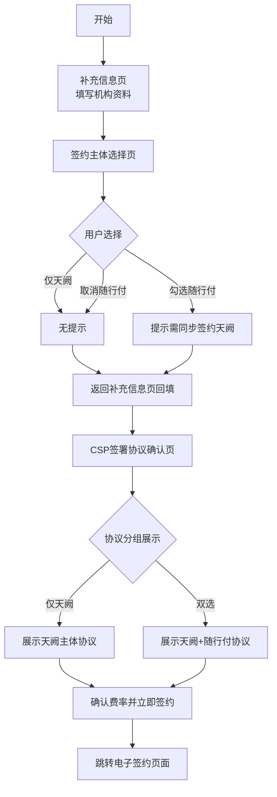

# CSP 机构双主体签约流程 PRD（业务版）

- 版本：v1.1
- 日期：2026-11-12
- 适用对象：业务、运营、BD
- 本地原型：`/Users/hailingdediannao/CodeBuddy/20261112063520/index-bd-review.html`

---

## 一、业务背景

CSP 机构入驻时，需要选择签约主体。当机构作业区域包含「五省二市」（黑龙江、吉林、辽宁、浙江、福建（厦门除外））时，必须同时签约两个主体：

- 随行付支付有限公司
- 北京天阙科技有限公司

两个主体对应四份协议，机构需在入驻流程中完成确认和电子签约。

---

## 二、业务流程

---

## 三、关键页面说明

### 3.1 补充信息页

- 展示机构信息、费率信息。
- 「签约主体」字段默认显示「天阙」。
- 点击进入签约主体选择页，返回后回填已选主体。

### 3.2 签约主体选择页

- 两个选项：天阙、随行付，使用方形复选框，支持多选。
- 默认勾选「天阙」，天阙复选框置灰且不可取消。
- 随行付可手动勾选/取消。

| 用户操作 | 页面表现 |
|---|---|
| 仅选择天阙 | 无提示 |
| 勾选随行付 | 展示提示：机构作业范围若含五省二市……需同步选择天阙主体进行签约 |
| 取消随行付 | 仅取消随行付，天阙保持勾选，无提示 |
| 点击天阙 | 无响应，保持默认勾选 |

### 3.3 CSP 签署协议确认页

- 顶部展示步骤条，当前为「签署协议」。
- 协议按主体分组展示：
  - 左侧：北京天阙科技有限公司 —— 合作服务协议、补充协议
  - 右侧：随行付支付有限公司 —— 外包服务协议、补充协议
- 根据上一步选择的签约主体动态展示：仅选天阙只显示左侧，双选显示两侧。
- 展示该机构开通产品的全部费率：
  - 标准费率：默认展开，包含微信支付、支付宝支付、银联二维码、刷卡、手机闪付、抖音支付等
  - 非标费率：默认折叠，点击可展开查看
    - 活动费率
    - 特殊行业费率：细分为非盈利、保险类、缴费类、私立院校、线上类、行业类1等子类
    - D0结算
    - 白条分期
- 点击「立即签约」后直接跳转电子签约页面。

---

## 四、需要业务确认的事项

1. 五省二市判定方式
   - [ ] 根据机构填写的「合作区域」自动判断
   - [ ] 由 BD 在后台标记
   - [ ] 由机构自行选择

2. 协议内容来源
   - [ ] 协议内容由法务提供固定模板
   - [ ] 不同机构类型展示不同协议
   - [ ] 后续接入电子签供应商（如法大大、e签宝）

3. 费率表数据
   - [ ] 费率表为固定展示，所有机构一致
   - [ ] 根据机构类型/区域动态渲染

4. 电子签约跳转
   - [ ] 跳转地址确认
   - [ ] 是否需要携带签约主体、协议列表等参数

---

## 五、待办事项

| 事项 | 负责人 | 截止时间 |
|---|---|---|
| 确认五省二市判定规则 | 业务/风控 | 待定 |
| 提供最终协议名称与内容 | 法务/合规 | 待定 |
| 确认费率表数据来源 | 业务/财务 | 待定 |
| 对接电子签供应商 | 技术/采购 | 待定 |

---

## 六、原型链接

| 页面 | 本地文件 |
|---|---|
| 统一导航首页 | `/Users/hailingdediannao/CodeBuddy/20261112063520/index-bd-review.html` |
| 补充信息页 | `/Users/hailingdediannao/CodeBuddy/20261112063520/supplement-info-v2.html` |
| 签约主体选择页 | `/Users/hailingdediannao/CodeBuddy/20261112063520/sign-entity-v2.html` |
| CSP 签署协议确认 | `/Users/hailingdediannao/CodeBuddy/20261112063520/csp-sign-confirm.html` |
