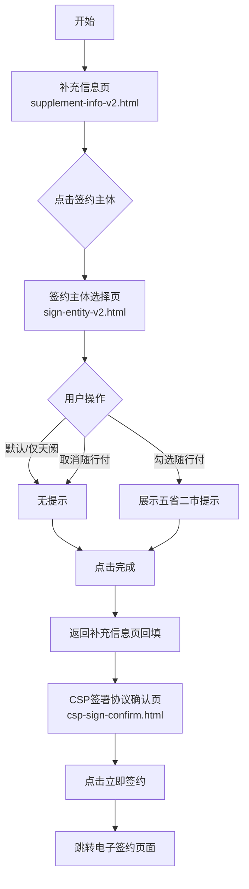

# CSP 机构签约主体流程 PRD

- 版本：v1.2
- 日期：2026-11-18
- 状态：已输出原型
- 本地原型：`/Users/hailingdediannao/CodeBuddy/20261112063520/index-bd-review.html`

---

## 一、背景

CSP 机构入驻时，若作业范围包含「五省二市」（黑龙江、吉林、辽宁、浙江、福建（厦门除外）），必须同时签约「随行付支付有限公司」和「北京天阙科技有限公司」两个主体。

本 PRD 描述最终采用的原型方案。

---

## 二、目标

1. 补充信息页展示「签约主体」入口，默认显示「天阙」。
2. 签约主体页使用复选框支持多选：天阙默认勾选且不可取消，随行付可手动勾选/取消。
3. CSP 签署协议确认页按主体分组展示协议，点击「立即签约」直接跳转电子签约。
4. 输出可点击静态原型。

---

## 三、页面流程

---

## 四、功能说明

### 4.1 统一导航首页（index-bd-review.html）

作为原型入口，左侧导航直接平铺三个页面。默认加载 supplement-info-v2.html。

- 导航项：补充信息页、签约主体选择页、CSP签署协议确认页。
- 点击导航项在右侧 iframe 加载对应页面，并更新顶部标题。

### 4.2 补充信息页（supplement-info-v2.html）

供机构填写入驻资料，并提供「签约主体」入口。

核心元素：
- 机构信息分组：签约主体、机构类型、业务类型、品牌名称、双方合作区域、是否修改协议、是否申请微信渠道号。
- 签约费率分组：精简版开关、线下费率、微信/支付宝费率、银联二维码费率等。
- 签约主体字段：默认展示「天阙」，点击跳转签约主体选择页；返回后按 localStorage 回填已选主体。

### 4.3 签约主体选择页（sign-entity-v2.html）

通过复选框选择签约主体。

核心元素：
- 页面标题：签约主体。
- 两个选项：天阙、随行付，右侧方形复选框。
- 默认勾选天阙，天阙复选框置灰且不可取消。
- 随行付可手动勾选/取消。
- 提示文案区。

交互规则：
- 仅天阙：无提示。
- 勾选随行付：展示提示「机构作业范围若含五省二市【黑龙江、吉林、辽宁、浙江、福建（厦门除外）】，需同步选择天阙主体进行签约。」
- 取消随行付：仅取消随行付，天阙保持默认勾选。
- 点击天阙：无响应，保持默认勾选。

### 4.4 CSP 签署协议确认页（csp-sign-confirm.html）

展示协议分组、费率信息，并提供立即签约入口。

核心元素：
- 顶部信息栏、步骤条。
- 协议分组：左侧为北京天阙科技有限公司，右侧为随行付支付有限公司；根据上一步选择的签约主体动态显示。
- 费率确认卡片：按费率分组展示产品类型和签约成本，不展示商户签约下限。
- 费率分组包括：扫码收款签约费率、银行卡收款签约费率、线上场景收款签约费率、智慧营销收款签约费率、特殊行业签约费率、营销活动签约费率、外卡收款签约费率、外卡特殊费率、增值产品签约费率。
- 立即签约按钮。

费率分组展示规则：
- 产品类型为空的费率分组不展示，不输出空分组标题、空表格或占位内容。
- 至少包含一个非空产品类型的费率分组正常展示。
- 扫码收款签约费率有产品类型时默认展开；其余有产品类型的分组默认收起，点击分组标题可展开或收起。
- 扫码收款签约费率为空时，该分组不展示，其余可见分组仍全部默认收起，不自动展开其他分组。

签约成本列规则：

| 费率分组 | 签约成本列 |
|---|---|
| 扫码收款、线上场景收款、智慧营销收款、特殊行业、营销活动、外卡特殊费率 | 借记卡费率、贷记卡费率 |
| 银行卡收款、外卡收款 | 借记卡费率、贷记卡费率、借记卡封顶 |
| 增值产品 | 费率、保底服务费、封顶服务费 |

---

## 五、交互规则

| 操作 | 结果 | 提示 |
|---|---|---|
| 默认 | 勾选天阙 | 无 |
| 勾选随行付 | 天阙保持勾选 | 五省二市需同步选择天阙 |
| 取消随行付 | 保留天阙 | 无 |
| 点击天阙 | 无响应 | 无 |
| 进入费率信息区域 | 隐藏产品类型为空的分组；扫码收款有数据时展开，其余可见分组收起 | 无 |
| 扫码收款无产品类型 | 不展示扫码收款分组，其他可见分组保持收起 | 无 |
| 点击已展示的费率分组标题 | 切换当前分组的展开或收起状态 | 无 |

点击「立即签约」后直接跳转电子签约页面（占位链接）。

---

## 六、数据说明

- localStorage key：`signEntities`，JSON 数组，如 `["天阙"]` 或 `["天阙","随行付"]`。
- 原型使用 `feeGroupData` 模拟费率数据，渲染前按产品类型是否非空过滤分组；后续接入接口时沿用相同的分组显隐和默认展开规则。

---

## 七、原型清单

| 页面 | 文件 |
|---|---|
| 统一导航首页 | index-bd-review.html |
| 补充信息页 | supplement-info-v2.html |
| 签约主体选择页 | sign-entity-v2.html |
| CSP签署协议确认（双主体） | csp-sign-confirm.html |
| CSP签署协议确认（仅天阙） | csp-sign-confirm-only-tianque.html |

---

## 八、后续可扩展

1. 协议预览接入真实 PDF / HTML。
2. 电子签约跳转替换为真实链接。
3. 动态费率接口化。
4. 用户勾选行为埋点。
